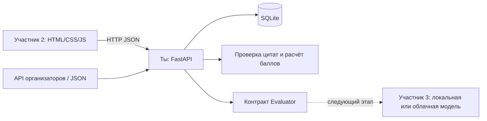

# CQA — backend команды из трёх человек

Python / FastAPI / SQLite. Backend поддерживает импорт диалогов, версии чек-листов, проверку ответов, расчёт баллов, историю, апелляции, пакетную обработку и отчёты. AI пока не подключён: автоматическая оценка возвращает `503 AI_NOT_CONFIGURED`. Frontend находится в `frontend/`; модель подключается отдельным участником через Evaluator.

## Запуск

Python 3.11+. Из корня этого репозитория в PowerShell:

```powershell
python -m venv .venv
.\.venv\Scripts\python.exe -m pip install -e ".[dev]" -c requirements-lock.txt
Copy-Item .env.example .env
.\.venv\Scripts\python.exe -m uvicorn backend.main:app --env-file .env --host 127.0.0.1 --port 8000
```

На Linux/macOS используются `.venv/bin/python` и `cp .env.example .env`. Активация окружения не обязательна.

- Swagger: <http://127.0.0.1:8000/docs>
- JSON-схема API: <http://127.0.0.1:8000/openapi.json>
- Проверка сервиса: <http://127.0.0.1:8000/health>
- База создаётся в `data/cqa.sqlite3`. Перезапуск сохраняет данные.

`.env` загружается через `uvicorn --env-file .env`. При другом запуске передайте переменные окружения явно. Подписанную ссылку организаторов поместите в `CQA_ORGANIZER_API_URL` только на сервере. Браузер вызывает `POST /api/v1/datasets/import-organizer` с `{"group_id":"DEV"}`; секретная ссылка в ответ не попадает. В `.env.example` реальных секретов нет.

## Проверить без модели

В другом терминале:

```powershell
.\.venv\Scripts\python.exe scripts/import_dataset.py examples/synthetic-dataset.json
.\.venv\Scripts\python.exe -m pytest -q
.\.venv\Scripts\python.exe -m ruff check backend scripts tests
.\.venv\Scripts\python.exe -m ruff format --check backend scripts tests
.\.venv\Scripts\python.exe -m mypy backend
```

Скрипт также принимает сохранённый JSON организаторов вида `{"isSuccess":true,"data":{"records":[...]}}`. Файл читается как UTF-8. `examples/synthetic-dataset.json` — искусственный пример для интерфейса, а не Ground Truth.

В Swagger можно импортировать набор, открыть диалог, создать чек-лист и выполнить **ручную** оценку через `/api/v1/evaluations/manual`. Она явно получает `origin: "manual"`. Это позволяет собрать UI до подключения AI. Тестовый evaluator существует только в тестах.

Для фронтендера готов [набор подключения](docs/frontend-handoff.md): Postman-коллекция и сценарий из 16 запросов. Команда `python scripts/frontend_kit.py` проверяет его на временной БД и сохраняет реальные примеры ответов и OpenAPI в `data/frontend-kit/`. С `--api http://127.0.0.1:8000` тот же сценарий создаёт демо-записи в запущенном backend.

## Устройство и роли



| Кто | Зона ответственности | Файлы / контракт |
| --- | --- | --- |
| Ты | Backend, хранение, импорт, версии, арифметика, апелляции | `backend/`, `tests/`, `scripts/` |
| Участник 2 | Список диалогов, редактор чек-листа, оценка с цитатами, апелляции, экспорт | `frontend/`; `/api/v1` |
| Участник 3 | Модель, промпт, точность RU/KZ/EN, сравнение с ручной разметкой | Будущий `ai/`; `Evaluator.evaluate()` |

Подробности: [архитектура](docs/architecture.md), [распределение на 22 часа](docs/team-tasks.md), [API для фронтенда](docs/api-contract.md), [контракт AI](docs/ai-integration.md).

Дополнительные возможности backend: [инструкция по пакетам, идемпотентности, диагностике и отчётам](docs/backend-operations.md).

- `Idempotency-Key` для безопасного повтора создания оценки и `X-Request-ID` для поиска ошибок.
- Ограничение параллельных оценок: `CQA_AI_CONCURRENCY=2` на процесс.
- POST `/api/v1/evaluation-batches` с необязательным Idempotency-Key; GET списка с пагинацией и GET по ID для прогресса. Задания и ключи сохраняются в SQLite.
- POST `/api/v1/reports/usage`: известные вызовы, токены, время и стоимость с явными ограничениями учёта.
- `python -m backend.benchmark`: сравнение явно выбранных AI-оценок с ручными эталонами без вызова модели.
- `CQA_TARIFFS_PATH`: файл тарифов; при отсутствии данных расход не подменяется нулём.

Перед интеграцией и сдачей: [что уже есть, какие материалы нужны и как провести ручную приёмку](docs/acceptance.md). Отдельно проверяются работоспособность интерфейса и точность реальной модели на ручной разметке.

В версии 0.2 HTTP, сценарии приложения, бизнес-правила и SQLite разделены. `main.py` собирает зависимости, `api.py` описывает типизированные HTTP-контракты, `services.py` выполняет сценарии, `domain.py` и `scoring.py` проверяют бизнес-правила, `db.py` отвечает за хранение и транзакции. Интерфейсы хранилища для сценариев определены в `ports.py`. Существующие URL и формат сохранённых данных совместимы с 0.1.

Бизнес-ошибки содержат код и сообщение; HTTP-статус назначается в `http.py`. Неверный результат адаптера и ошибка реализации сервера различаются: ожидаемые ошибки данных дают `AI_INVALID_RESULT`, внутренние ошибки — `INTERNAL_ERROR`. Общие типы языка, канала, доказательства и проверки непустого содержимого находятся в `value_types.py`. Новые имена и комментарии из одних пробелов отклоняются с 422; содержимое допустимых строк и исходных транскриптов не обрезается.

Тесты разделены: `python -m pytest tests/unit -q` проверяет правила и модели без FastAPI и SQLite, `python -m pytest tests/integration -q` — HTTP, адаптер организаторов и настоящие транзакции. Общая команда `python -m pytest -q` запускает обе группы. В CI группы выполняются отдельными шагами.

## Реализовано и проверяется тестами

- Чаты и транскрипты звонков, RU/KZ/EN, сохранение исходного текста и времени, ссылки на аудио.
- Базовые 8 критериев и произвольные новые чек-листы. Каждое изменение создаёт версию.
- Шкалы, разрешённый N/A, точные цитаты и обязательные пояснения проверяются до сохранения.
- `score = 100 × Σ(weight × value/max) / Σ(applicable weight)`. Двоичные ответы дают 0 или 1. Грубые нарушения остаются отдельным флагом. Нет применимых весов — `null`.
- Снимки диалога и правил, SHA-256 входа, оригинальная и итоговая оценка, метаданные модели.
- Апелляции с новой цитатой, журналом решения и защитой от одновременного перезаписывания.
- JSON-экспорт набора, оценок и апелляций; ограничения размера и CORS.
- Чтение истории и экспорт в согласованном снимке БД; конкурентные решения ревьюеров не перезаписывают друг друга.
- SQLite выполняется вне event loop; отдельные ошибки модели и хранилища, тайм-ауты, фильтрация query-параметров URL в логах HTTPX.
- Полные схемы успешных ответов и ошибок в OpenAPI, строгая проверка типов, линтер и форматирование в CI.

Локально проверен импорт всех 65 DEV-диалогов: 35 RU / 15 KZ / 15 EN, 60 чатов / 5 звонков. Тексты и временные отметки сохранены. Сам набор в репозитории не хранится.

Для 0.2 также проверено открытие БД, созданной исходным коммитом `658655d`, включая оценку после апелляции. Прежняя оценка, история и экспорт сохраняются. Тесты проверяют поведение и конфликты транзакций; CI запускает проверки на Python 3.11 и 3.12.

Настройки тайм-аутов: `CQA_EVALUATION_TIMEOUT=180` для AI-вызова и `CQA_DATABASE_TIMEOUT=15` для ожидания блокировки SQLite, в секундах. При `STORAGE_BUSY` сначала перечитайте текущее состояние. Запросы записи автоматически не повторяются; после обрыва соединения проверьте историю перед повтором.

## Текущие границы

Это backend для локального хакатонного демо: без авторизации и анализа аудио. Пакетная очередь хранится в SQLite и обрабатывается внутри приложения. Имена автора и ревьюера — подписи, а не проверенные аккаунты. Для совместного демо используйте один экземпляр сервера и одну базу; перед публичным размещением потребуется авторизация. Точность AI ещё не измерена: Gemini-адаптер и согласованную ручную разметку нужно подготовить отдельно.

Начальные правила перенесены из `CQA_Chat_Quality_Checklist 1.pdf`; адаптация звонков учитывает переданное разъяснение организаторов. Критерии редактируются как данные. Продуктовый справочник и выбор модели остаются задачей AI-участника.
