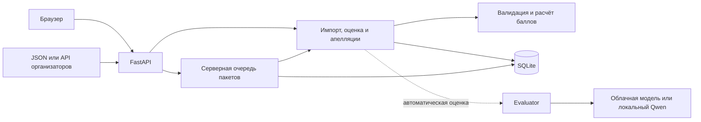

# Replimetr — контроль качества клиентских диалогов

Replimetr помогает экспертам по качеству и руководителям поддержки проверять
чаты и транскрипты звонков по единым правилам. Эксперт видит баллы, цитаты из
разговора и историю пересмотра оценки. Проект создан для кейса Freedom Broker.
Поддерживаются диалоги на русском, казахском и английском.

**[Открыть демо для жюри](https://replimetr.alwaysdata.net/#dialogs).** Введите
эти данные в окне входа браузера.

- **Логин:** `jury`
- **Пароль:** команда передаёт отдельно.

В учебном наборе уже есть сохранённая AI-оценка.

## Что реализовано

| Возможность | Что можно сделать |
| --- | --- |
| Диалоги | Загрузить набор JSON, отфильтровать чаты и звонки, открыть транскрипт с ролями и временем реплик |
| Чек-листы | Выбрать версию базового чек-листа Freedom Broker из восьми критериев или создать свой со шкалами, N/A и флагами нарушений |
| Оценка | Проверить диалог вручную или с AI, прочитать обоснования по критериям и перейти из цитаты к исходной реплике |
| История и апелляции | Сравнить исходную и итоговую оценку, оспорить критерий, сохранить решение и новую ревизию |
| Пакетная обработка | Оценить несколько диалогов, следить за прогрессом, отменить ожидающие задания и продолжить обработку после безопасных отказов по лимиту |
| Отчёты и выгрузки | Сравнить оценки AI с выбранными ручными эталонами, увидеть расход, скачать архив набора или JSON 1.0 для сдачи |

## Как работает решение

1. Эксперт загружает JSON с диалогами или импортирует набор через настроенный API организаторов.
2. Выбирает разговор и версию чек-листа. Запускает оценку AI или вносит её вручную.
3. Сервер проверяет структуру ответа, допустимые значения и совпадение цитат с репликами. Затем рассчитывает итог и сохраняет оценку вместе со снимками диалога и правил.
4. Эксперт открывает результат и при необходимости подаёт апелляцию. Решение создаёт новую ревизию, исходная оценка остаётся в истории.
5. Команда выгружает архив для работы или формирует отдельный файл для организаторов.

Итог на шкале 0–100 рассчитывает backend. Для бинарных критериев «Да» даёт
полный вес, «Нет» — ноль. Значение числовой шкалы делится на её максимум.
Вес N/A исключается из знаменателя. Когда применимых весов нет, итог равен
`null`. Грубые нарушения хранятся отдельными флагами.

## Технологии

| Компонент | Технологии |
| --- | --- |
| Интерфейс | HTML, CSS, JavaScript ES Modules и Fetch API. Сборка и npm-зависимости для запуска не нужны |
| Сервер | Python 3.11+, FastAPI, Pydantic, Uvicorn, HTTPX и python-dotenv |
| Хранение | SQLite в режиме WAL, транзакции, снимки входов и версий чек-листов |
| AI | Gemini 3.8 Flash через aijuju Responses API в демо. Есть адаптер прямого Google Gemini API и отдельный локальный режим Qwen3-4B с QLoRA |
| Развёртывание и проверки | alwaysdata для демо, Docker Compose для backend, GitHub Actions, pytest, Ruff, mypy и тесты frontend на Node.js |

Зависимости и версии зафиксированы в [pyproject.toml](pyproject.toml) и
[requirements-lock.txt](requirements-lock.txt). Подготовка GPU и весов для
локального Qwen описана отдельно. [Локальный запуск модели](docs/ai-local-handoff.md).

## Архитектура



- [backend/](backend/) — HTTP API, проверка ответов, расчёт баллов, очередь, отчёты и резервные копии.
- [ai/](ai/) — адаптеры моделей и выбор провайдера через `CQA_AI_PROVIDER`.
- [frontend/](frontend/) — интерфейс эксперта, который работает через HTTP API.
- [scripts/](scripts/) и [tests/](tests/) — сценарии проверки и тесты.

В hosted-режиме Uvicorn обслуживает интерфейс и API на одном адресе. Сайт может
проверять общий логин и пароль на всех маршрутах. [Архитектура](docs/architecture.md) ·
[Контракт API](docs/api-contract.md) · [Защита доступа](docs/access-control.md).

## Установка и запуск

Понадобятся Git и Python 3.11 или 3.12. Для ручной проверки достаточно одного
локального сервера и синтетического примера.

```text
git clone --single-branch --branch main https://github.com/8zellorr8/data_ch.git
cd data_ch
```

**Windows, PowerShell**

```powershell
python -m venv .venv
.\.venv\Scripts\python.exe -m pip install -e ".[dev]" -c requirements-lock.txt
$env:CQA_FRONTEND_PATH = (Resolve-Path frontend).Path
.\.venv\Scripts\python.exe -m uvicorn backend.hosting:create_hosted_app --factory --host 127.0.0.1 --port 8101
```

**Linux и macOS**

```bash
python3 -m venv .venv
.venv/bin/python -m pip install -e ".[dev]" -c requirements-lock.txt
export CQA_FRONTEND_PATH="$PWD/frontend"
.venv/bin/python -m uvicorn backend.hosting:create_hosted_app --factory --host 127.0.0.1 --port 8101
```

Откройте [локальный интерфейс](http://127.0.0.1:8101/#dialogs) или
[Swagger](http://127.0.0.1:8101/docs). SQLite создаётся в `data/cqa.sqlite3`,
если путь `CQA_DATABASE_PATH` не задан. Для остановки нажмите `Ctrl+C`.

Для локальной AI-оценки создайте `.env` на основе [.env.example](.env.example)
или обновите существующий. Выберите провайдера и задайте его ключ на сервере.
У aijuju платные вызовы включаются параметром `CQA_LLM_API_ENABLED=1`. Затем
замените в команде запуска `backend.hosting:create_hosted_app` на
`ai.app:create_hosted_app` и добавьте `--env-file .env`.
[Настройка AI и учёта токенов](docs/integration.md).

Для отдельного frontend-прокси запустите `python frontend/serve.py --api http://127.0.0.1:8101`
с запущенным локальным API и откройте [порт 5173](http://127.0.0.1:5173).
Для отдельного запуска backend в контейнере используйте
`docker compose up --build --detach --wait --wait-timeout 120`.
[Инструкция по Docker и резервным копиям](docs/deployment.md).

## Как проверить решение

**На демо для жюри**

1. Откройте [Replimetr](https://replimetr.alwaysdata.net/#dialogs) и введите логин `jury` и пароль, полученный от команды.
2. В разделе «Диалоги» выберите «Учебный набор для жюри». Откройте `DEMO-RU-001` стрелкой в строке.
3. В блоке «Результат проверки» откройте сохранённую запись AI из «Истории оценок». Посмотрите итог, ответы по восьми критериям и пояснения.
4. Нажмите «К сообщению» под цитатой и сверьте её с репликой в транскрипте.

**Локально, без ключа AI**

В пустом интерфейсе нажмите «Открыть пример», выберите диалог и нажмите
«Оценить вручную». Укажите балл, пояснение и цитату. Сохраните оценку и
откройте её в истории.

Для готового сквозного примера запустите из корня проекта при работающем
сервере и активированной `.venv`:

```text
python scripts/frontend_kit.py --api http://127.0.0.1:8101
```

Ожидаемый итог — `OK: 16 API steps`. Скрипт создаёт синтетический набор, ручную
оценку и апелляцию. В учебном сценарии итог меняется с 75 до 100, исходная оценка
сохраняется. Для проверки во временной базе отдельно доступна команда
`python -m scripts.rehearse_backend`. [Сценарий репетиции](docs/backend-rehearsal.md).

**Проверки кода**

```text
python -m pytest -q
python -m ruff check backend ai scripts tests
python -m ruff format --check backend ai scripts tests
python -m mypy backend ai scripts/rehearse_backend.py
python -m scripts.check_secrets
npm --prefix frontend run check
npm --prefix frontend test
python -m unittest discover -s frontend/tests -p "test_*.py"
```

Команды Python рассчитаны на активированную `.venv`. Если окружение не
активировано, используйте путь к его Python из раздела установки вместо
`python`. Node.js нужен для проверок frontend. [Настройки CI](.github/workflows/backend.yml).

## Данные и интеграции

- **JSON:** диалоги импортируются через `POST /api/v1/datasets`. Для проверки есть [синтетический пример](examples/synthetic-dataset.json) и [учебный набор интерфейса](frontend/demo-dataset.json).
- **API организаторов:** backend загружает набор по `group_id`. Подписанная ссылка задаётся в `CQA_ORGANIZER_API_URL` на сервере.
- **Чек-лист Freedom Broker:** [начальные правила](backend/default_checklist.json) включают восемь критериев и отдельные текстовые правила для звонков. Новые версии сохраняются в SQLite.
- **Модель:** в демо используется Gemini 3.8 Flash через aijuju. Backend передаёт модели транскрипт и выбранные правила. Ключи и настройки провайдера хранятся в серверном окружении.

### Сдача организаторам

В разделе «Сдача результатов» выберите набор и режим DEV или PROD. Укажите
фактически использованные модели. Выберите завершённый пакет на весь набор
или задайте исходную AI-оценку либо ошибку для каждого диалога.
Скачайте отдельный `results.json` в формате 1.0 и проверьте его через
`backend.submission_check`. Для проверки через защищённый сайт настройте
`CQA_SUBMISSION_HTTP_USER` и `CQA_SUBMISSION_HTTP_PASSWORD`.

Подготовьте `results/dev/results.json` для 65 диалогов DEV и
`results/prod/results.json` для 10 контрольных чатов PROD. После проверки
добавьте файлы в Git и выполните push. Архив набора предназначен для просмотра
диалогов и истории.
[Формат, команды и порядок сдачи](docs/submission.md).

## Ограничения

- AI оценивает текст транскрипта. Интерфейс может показать запись по внешней ссылке, а автоматическая транскрибация и анализ голоса не реализованы.
- Backend проверяет, что цитата существует в выбранной реплике. Оценка её смысла и проверка продуктовых фактов остаются задачей эксперта. Продуктовый справочник не подключён.
- Сохранённый пример подтверждает прохождение сценария от транскрипта до результата. Точность на независимой экспертной разметке пока не подтверждена.
- У hosted-демо общий вход без разграничения ролей. Автоматическая оценка зависит от доступности провайдера и настроенной квоты.

## Развёрнутая версия

Демо размещено на alwaysdata. Интерфейс и API работают по HTTPS с общим входом
для команды и жюри. [Replimetr](https://replimetr.alwaysdata.net/#dialogs) ·
[Swagger API](https://replimetr.alwaysdata.net/docs) ·
[Инструкция по хостингу](docs/alwaysdata.md).
