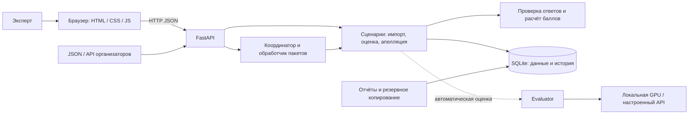

# Replimetr — контроль качества клиентских диалогов

Replimetr — рабочее место эксперта по качеству обслуживания: импорт диалогов,
оценка по настраиваемому чек-листу, проверяемые цитаты, пересмотр результатов
и история решений. Проект помогает специалистам контроля качества и руководителям
поддержки хранить правила и обоснования оценки вместе с исходным разговором.

Решение разрабатывается для кейса Freedom Broker. Поддерживаются чаты и
транскрипты телефонных звонков с языками RU, KZ и EN.

**Общая ветка `main`** содержит frontend, backend и AI из `codex/integration`.
Для автоматической оценки интеграция использует **aijuju API** с моделью
**`gemini-3.8-flash`**. Ключ `CQA_LLM_API_KEY` задаётся в окружении сервера.

Проверен настоящий запрос из браузера: восемь критериев, дословные цитаты,
сохранение в SQLite и расчёт балла backend. Один синтетический тест занял
11,86 секунды; провайдер сообщил 4 034 токена. Это проверка подключения,
а не измерение точности на экспертном эталоне.

[Запуск общей версии и настройки API](docs/integration.md).
Локальный Qwen4B доступен как отдельный вариант: [инструкция](docs/ai-local-handoff.md)
и [его собственные результаты](docs/ai-local-4b-validation.json).

## Что реализовано

| Возможность | Что доступно |
| --- | --- |
| Диалоги | Импорт JSON, список наборов, фильтры, просмотр сообщений с ролями и временем; ссылка на запись звонка при наличии audio_url |
| Чек-листы | Базовые 8 критериев Freedom Broker и редактор произвольных правил: бинарные ответы, числовые шкалы, N/A и флаги нарушений; сохранение версий |
| Ручная оценка | Ответ, объяснение и цитата для каждого критерия; проверка допустимых значений и совпадения цитаты с сообщением; итог рассчитывает backend |
| История и апелляции | Исходная и итоговая оценка, снимки диалога и правил, решения ревьюера, защита от конфликтующих изменений |
| Экспорт | JSON с диалогами, оценками и апелляциями выбранного набора |
| Сдача организаторам — API/CLI | Отдельный JSON 1.0: все 65 DEV / 10 PROD, внешние ID критериев, номера реплик, явные ошибки; исходные AI-оценки без ручных исправлений |
| Проверка готовности — CLI | Проверка выбранной выгрузки через локальную SQLite или HTTP; отдельный статус ошибок диалогов, сверка скачанного results.json, без запуска AI |
| Надёжность API | Idempotency-Key для создания оценок и пакетов, ограничения нагрузки, тайм-ауты, стабильные коды ошибок и идентификаторы запросов |
| Пакеты — backend API | Сохранённая очередь, отмена ожидающих заданий, отложенные повторы после 429 и продолжение без повторной оценки успешных элементов; требуется Evaluator |
| Отчёты — backend API/CLI | Сравнение явно выбранных AI-оценок и ручных эталонов; покрытие, MAE, ошибки N/A и флагов; отчёт известного расхода по данным адаптера и настроенным тарифам |
| Резервные копии — CLI | Снимок работающей SQLite, манифест с SHA-256, проверка целостности и восстановление в новый файл без повторного запуска незавершённых заданий |

В интерфейсе доступны диалоги, чек-листы, оценки, апелляции, серверные пакеты,
отчёты качества/расхода и отдельная выгрузка для сдачи. Скачанный `results.json`
нужно самостоятельно добавить в нужную папку `results/` и отправить в Git.

В режиме прямого Google API запросы ограничены `CQA_GEMINI_RPM=3` на модель.
Для aijuju используется отдельная настройка `CQA_LLM_RPM=15`, включая повторы.
Сервер сохраняет интервалы и 429-паузы в SQLite. `CQA_BATCH_RATE_RETRIES=3`
ограничивает автоматические повторы пакета; `POST /api/v1/evaluation-batches/{id}/resume`
возобновляет только безопасные отказы по квоте, сохраняя готовые результаты.
Это не увеличивает квоту Google. [Контракт, настройки и ограничения](docs/backend-operations.md#10-частота-запросов-429-и-продолжение-пакета).

## Как работает решение

1. Пользователь импортирует JSON с диалогами или запрашивает DEV через настроенный
   серверный API организаторов.
2. Открывает разговор и выбирает конкретную версию чек-листа.
3. Запускает AI-оценку при настроенном провайдере или заполняет ручную оценку.
   Evaluator получает новый диалог и выбранную версию правил; готовых ответов
   по ID диалога в адаптере нет.
4. Backend проверяет структуру ответа, шкалы, N/A и цитаты, затем рассчитывает
   баллы и сохраняет оценку вместе со снимками входных данных.
5. Эксперт просматривает результат и доказательства. При апелляции сохраняются
   решение, новая ревизия и пересчитанный итог; исходная оценка остаётся доступна.
6. Результаты можно экспортировать. При наличии реальных AI-оценок и ручных
   эталонов их можно сопоставить через отчёт качества.

### Правила расчёта

Итог рассчитывается на backend, а не в браузере или модели:

```text
Итог = 100 × Σ(вес × нормализованное значение) / Σ(применимые веса)
```

- Для бинарного критерия «Да» даёт полный вес, «Нет» — ноль.
- Для шкалы значение делится на её максимум. В базовом чек-листе консультация
  допускает только 0/5/10/15/20, ведение диалога — 0/4/7/10.
- N/A разрешён только правилами критерия; его вес исключается из знаменателя.
- Если применимых весов нет, итог равен `null`, а не нулю.
- Итог округляется до двух знаков. Грубые нарушения учитываются отдельными флагами.

Точная цитата подтверждает связь с исходной репликой. Её смысловая уместность и
правильность консультации требуют экспертной оценки; совпадение текста само по
себе их не доказывает.

## Технологии

| Компонент | Технологии |
| --- | --- |
| Backend | Python 3.11+, FastAPI, Pydantic, Uvicorn |
| Хранение | SQLite в режиме WAL, транзакции; JSON-снимки правил, диалогов и оценок |
| Внешние HTTP-запросы и конфигурация | HTTPX, python-dotenv, переменные окружения |
| Frontend | HTML, CSS, JavaScript ES Modules, Fetch API; без сборки и npm-зависимостей |
| Расчёт и резервное копирование | Decimal, sqlite3 backup API и SHA-256 из стандартной библиотеки Python |
| Контроль качества кода | pytest, Ruff, mypy; GitHub Actions на Python 3.11 и 3.12 |
| AI | Gemini 3.8 Flash через aijuju Responses API; локальный Qwen4B включается отдельно. Баллы рассчитывает backend |

Зависимости описаны в [pyproject.toml](pyproject.toml), проверенные версии — в
[requirements-lock.txt](requirements-lock.txt). Node.js нужен для синтаксических
проверок и тестов frontend; эти проверки также запускаются в CI.

## Архитектура



HTTP-обработчики отвечают за контракт API. Сценарии получают зависимости явно,
бизнес-правила отделены от FastAPI и конкретной модели. Данные и задания хранятся
в SQLite; обработчик пакетов работает внутри backend-процесса.

```text
backend/     API, бизнес-правила, SQLite, адаптеры, очередь, отчёты и backup CLI
ai/          Gemini, промпт, проверка подключения, экспериментальные утилиты LoRA
frontend/    браузерный интерфейс без сборки
scripts/     импорт данных и воспроизводимый API-сценарий
examples/    синтетические данные, Postman-запросы, примеры тарифов и сравнения
tests/       модульные и интеграционные тесты
docs/        архитектура, контракты, запуск и план приёмки
```

Подробности: [архитектура](docs/architecture.md), [контракт API](docs/api-contract.md),
[инструкция frontend-участнику](docs/frontend-handoff.md),
[контракт AI-адаптера](docs/ai-integration.md).

[Общая main, работа втроём и проверки перед объединением](docs/team-workflow.md).

## Установка и запуск

**Сдача результатов:** [формат JSON 1.0 и команды](docs/submission.md).
Организаторам нужны `results/dev/results.json` и `results/prod/results.json`.
Для выгрузки с хостинга доступна команда (манифест заполняется по инструкции):

```text
python -m backend.submission_remote --api https://replimetr.alwaysdata.net --dataset-id DATASET_UUID --manifest data/submission-dev.json
```

Обычный архивный экспорт их не заменяет. На контрольные 10 чатов, проверку и
push отводится один час; реальные результаты появятся после подключения AI.

Для запуска только backend через Docker (без установки Python на хост):

```text
docker compose up --build --detach --wait --wait-timeout 120
```

Нужен работающий Docker с Linux containers и Compose 2.30+. SQLite хранится в
постоянном томе `replimetr_backend-data`, API доступен на `http://127.0.0.1:8000`.
Frontend эта команда не запускает. Gemini включается ключом в `.env.docker`;
без ключа сохраняется ручной режим. [Настройки, деплой на сервер, резервные
копии и проверка сохранности данных](docs/deployment.md).

### Нативный запуск

Нужны Git и Python. В CI проверяются Python 3.11 и 3.12; отдельный чистый клон
проверен на Windows / Python 3.12.14. Если репозиторий недоступен без авторизации,
потребуется GitHub-аккаунт с правами на него. Ниже указана текущая ветка решения.

### 1. Клонировать проект

```text
git clone --single-branch --branch main https://github.com/8zellorr8/data_ch.git
cd data_ch
python --version
```

### 2. Установить и запустить backend

PowerShell, из корня репозитория:

```powershell
python -m venv .venv
.\.venv\Scripts\python.exe -m pip install -e ".[dev]" -c requirements-lock.txt
if (-not (Test-Path -LiteralPath .env)) { Copy-Item .env.example .env }
.\.venv\Scripts\python.exe -m uvicorn ai.app:app --env-file .env --host 127.0.0.1 --port 8000
```

Для автоматической оценки запускайте `ai.app:app` вместо `backend.main:app`.
В `.env.example` выбран aijuju с выключенными платными вызовами. Для активации
обновите настройки существующего `.env` по [инструкции](docs/integration.md).
Настройка локальной модели: [docs/ai-local-handoff.md](docs/ai-local-handoff.md).
Инструкция по Gemini и разметке:
[docs/ai-gemini.md](docs/ai-gemini.md).
Проверенные бесплатные квоты, качество RU/KZ/EN и настройки для backend:
[docs/ai-provider-check.md](docs/ai-provider-check.md).
Экспериментальное локальное обучение Qwen3 через LoRA и запуск без Gemini-ключа:
[docs/ai-lora.md](docs/ai-lora.md).

На Linux/macOS создайте окружение командой `python3 -m venv .venv`, используйте
`.venv/bin/python` вместо `.venv\Scripts\python.exe`, а для первого создания
конфигурации — `cp .env.example .env`. Существующую `.env` сохраняйте.

Для ручного демо ключ AI и ссылка организаторов не нужны. Оставьте
`CQA_ORGANIZER_API_URL` и `CQA_TARIFFS_PATH` пустыми. SQLite создаётся автоматически
в `data/cqa.sqlite3`. Запускайте сервер из корня проекта: этот путь относительный.
Переменные окружения процесса имеют приоритет над `.env`.

### 3. Запустить frontend

Во втором терминале, также из корня репозитория:

```text
python frontend/serve.py --api http://127.0.0.1:8000
```

Откройте [интерфейс](http://127.0.0.1:5173). Нельзя просто открыть index.html как
локальный файл: ES-модулям нужен HTTP-сервер. Браузер обращается к своему origin,
а приведённая команда передаёт API-запросы на `http://127.0.0.1:8000`.
Запуск `frontend/serve.py` без `--api` использует общий сервер команды.
Origin `http://127.0.0.1:5173` уже включён в `.env.example`.
Остановка каждого сервера — Ctrl+C в соответствующем терминале.

Полезные адреса:

- [Swagger — интерактивные запросы](http://127.0.0.1:8000/docs).
- [OpenAPI — схема API](http://127.0.0.1:8000/openapi.json).
- [Health](http://127.0.0.1:8000/health): без модели ожидается `ai_configured: false`.

Подробная инструкция и диагностика ошибок: [запуск backend без AI](docs/backend-no-ai.md).

## Как проверить решение

### Полная техническая репетиция без AI

```text
python -m scripts.rehearse_backend
```

Команда сама запускает временный HTTP-сервер, выполняет ручной сценарий,
проверяет DEV/PROD-выгрузки с явными ошибками отсутствующего AI и сохранность
данных после перезапуска. Рабочие `.env`, база и results/ не используются.
Тестовый Evaluator не добавляется. [Этапы, изоляция и ограничения](docs/backend-rehearsal.md).

### Воспроизводимый сценарий для жюри без AI

После запуска backend в ещё одном терминале выполните из корня репозитория:

```powershell
.\.venv\Scripts\python.exe scripts/frontend_kit.py --api http://127.0.0.1:8000
```

Ожидаемый результат — `OK: 16 API steps`. Скрипт создаёт **синтетический** набор,
демонстрационный чек-лист, ручную оценку и апелляцию через настоящий HTTP API.
Проверяются допустимые ответы, N/A, конфликт повторной апелляции и пересчёт:
исходный балл **75** сохраняется, итоговый после решения становится **100**,
ревизия увеличивается до **2**. Это демонстрация поведения, не Ground Truth.

1. Обновите интерфейс и выберите созданный набор «Искусственный пример для интерфейса».
2. Откройте диалог, историю оценки, цитаты и решение апелляции. Сверьте исходный
   и итоговый баллы.
3. Скачайте JSON-экспорт. Остановите и снова запустите backend с прежним путём БД:
   диалог, оценка и история должны сохраниться.
4. В редакторе чек-листов создайте новую версию и проверьте её в новой ручной оценке.
   Сохранённая ранее оценка должна остаться связана со своей версией правил.

ID и ответы сценария сохраняются в `data/frontend-kit/responses.json`, схема API
и Postman-коллекция — рядом. Каждый прогон создаёт новые демонстрационные записи.
Без `--api` скрипт использует отдельную временную БД; это не проверка сетевого запуска.

Без ключа новый запрос автооценки или создания AI-пакета должен вернуть
`503 AI_NOT_CONFIGURED`. Без серверной ссылки импорт организаторов возвращает
`503 ORGANIZER_NOT_CONFIGURED`; файловый импорт продолжает работать.

### Автоматические проверки

```powershell
.\.venv\Scripts\python.exe -m pytest -q
.\.venv\Scripts\python.exe -m ruff check backend ai scripts tests
.\.venv\Scripts\python.exe -m ruff format --check backend ai scripts tests
.\.venv\Scripts\python.exe -m mypy backend ai scripts/rehearse_backend.py
.\.venv\Scripts\python.exe -m scripts.check_secrets
```

В [зафиксированном прогоне чистого клона](docs/backend-no-ai.md#зафиксированный-результат)
прошли 203 теста, Ruff, форматирование и mypy. Тесты проверяют правила расчёта,
цитаты, транзакции, конфликты, пакеты, отчёты и восстановление на синтетических
данных. Тестовые Evaluator не являются настоящей AI-моделью.

Дополнительные команды описаны отдельно:
[пакеты, идемпотентность и отчёты](docs/backend-operations.md),
[резервное копирование и восстановление](docs/backup-restore.md).

### Перед сдачей результатов

Из локального клона, с манифестом явного выбора оценок/пакета:

```text
python -m backend.submission_check --api https://replimetr.alwaysdata.net --dataset-id DATASET_UUID --manifest data/submission-dev.json
```

Для локальной БД замените `--api ...` на `--database data/cqa.sqlite3`.
После экспорта добавьте `--results-file results/dev/results.json --json`.
Код выхода 0 — выгрузка валидна; 1 — валидна, но содержит ошибки диалогов;
2 — проверка заблокирована. Без `--results-file` существование файла не проверяется.
AI, запись файлов, commit и push команда не выполняет; точность модели и срок
сдачи она не подтверждает. [Манифесты, статусы и полный порядок сдачи](docs/submission.md).

## Данные и интеграции

- **Собственные JSON-наборы:** `POST /api/v1/datasets`. В репозитории есть
  [синтетический пример](examples/synthetic-dataset.json) и отдельный учебный набор
  для кнопки «Открыть пример» в интерфейсе. Это не реальные данные клиентов и не эталоны.
- **API организаторов:** backend получает набор по group_id через HTTP GET.
  Полная подписанная ссылка задаётся в `CQA_ORGANIZER_API_URL` только на сервере;
  клиент вызывает `POST /api/v1/datasets/import-organizer`. Секреты и реальные
  данные не требуются для воспроизведения синтетического сценария.
- **Правила Freedom Broker:** начальная конфигурация находится в
  [default_checklist.json](backend/default_checklist.json); пользовательские версии
  сохраняются в SQLite. Для звонков предусмотрены отдельные текстовые правила.
- **Аудио:** сохраняется audio_url, интерфейс показывает плеер при наличии ссылки.
  Backend не скачивает и не распознаёт аудио.
- **AI:** `ai.app:app` выбирает адаптер по `CQA_AI_PROVIDER` и подключает его
  через `Evaluator.evaluate()`. [Параметры aijuju и проверка статуса](docs/integration.md).
- **Отчёты:** quality использует явные ID и ревизию ручного эталона, без вызова AI.
  Расход рассчитывается только по известным данным адаптера и заданным тарифам;
  неизвестная стоимость не подменяется нулём. Пример тарифов в examples — вымышленный.

Реальные наборы, ручную разметку, резервные копии и ключи следует хранить вне Git.
Основные настройки описаны в [.env.example](.env.example).

## Ограничения текущей версии

- Реальный вызов Gemini 3.6 Flash проверен на синтетическом диалоге: 8 ответов
  прошли проверку схемы и цитат. Это не измерение точности на DEV или Ground Truth.
  Для Flash Lite AI-участник также выполнил DEV-прогон; сравнение использовало
  предварительные метки, не экспертный эталон. [Отчёт](docs/ai-provider-check.md).
  Точность на независимом Ground Truth пока не подтверждена. Метрики quality
  являются внутренними метриками команды, а не официальной формулой рейтинга хакатона.
- Hosted-режим поддерживает общий вход для команды и жюри. Разграничение
  ролей не предусмотрено, автор и ревьюер остаются текстовыми подписями.
  Docker по умолчанию публикует API только на loopback.
  [Настройка защиты и проверка доступа](docs/access-control.md).
- Анализируется текст транскрипта; дикция, темп, произношение и автоматическая
  транскрибация не реализованы. Воспроизведение записи зависит от внешнего URL.
- Продуктовый справочник для проверки финансовых фактов в решение не подключён.
- В карточке пакета кнопка «Продолжить пакет» отправляет на повтор элементы,
  которые завершились безопасным отказом по лимиту. Сохранённые оценки остаются
  в пакете. Создание нового AI-пакета требует модели.
- Ограничение параллельности AI действует на процесс. Очередь хранится в SQLite;
  отдельного распределённого обработчика или Redis нет.
- Черновики форм и ключи запросов frontend хранятся в `sessionStorage` текущей
  вкладки. Перезагрузка поддерживается, закрытие вкладки может удалить черновик.
- Backup CLI поддерживает текущую схему и файловую систему с hard links;
  восстановление приостанавливает незавершённые задания для ручной проверки.

Запуск backend без AI и один синтетический вызов через aijuju проверены отдельно.
Перед сдачей проверьте все сценарии на новых диалогах и сформируйте официальные
выгрузки. [План проверки перед сдачей](docs/acceptance.md).
Историческая [приёмка без AI](docs/backend-readiness.md) отделяет HTTP-проверки,
действия в браузере и оставшиеся проверки настоящей модели. Hosted-фабрика
принимает готовый Evaluator: [контракт подключения](docs/ai-integration.md).

## Развёрнутая версия

**[Открыть Replimetr](https://replimetr.alwaysdata.net/)** ·
[Swagger API](https://replimetr.alwaysdata.net/docs).

Размещено на alwaysdata Free: приложение работает на сервере, SQLite хранится
отдельно от кода. Перезапуск и восстановление резервной копии проверены.
Публичное демо содержит синтетические диалоги и работает на отдельном релизе.
Обновление `main` и переключение сайта на новый релиз выполняются отдельно.
[Настройки, обновление, резервирование и условия бесплатного хостинга](docs/alwaysdata.md).
