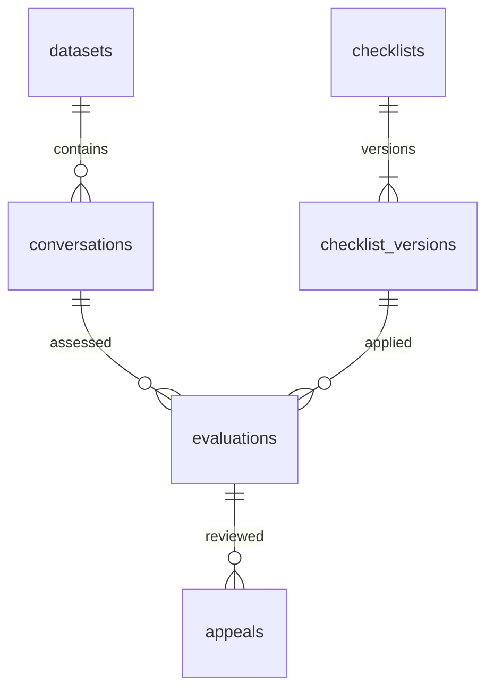

# Архитектура

Один Python-сервис, один SQLite-файл, отдельный браузерный клиент и заменяемый AI-адаптер. Такой объём можно интегрировать за 22 часа. Redis, отдельный сервер БД и микросервисы сейчас не нужны.

## Поток оценки

1. Backend принимает новый набор из JSON или получает его по подписанной ссылке из серверной переменной окружения.
2. Проверяет весь набор до записи; импорт выполняется одной транзакцией.
3. Назначает внутренние UUID диалогам и `m1`, `m2`, … сообщениям. Внешний `conversation_id`, текст, язык, канал и время сохраняет.
4. UI передаёт внутренний UUID диалога и **конкретную** версию чек-листа.
5. Backend передаёт полные тексты и правила в `Evaluator`. Пока адаптера нет, этот шаг возвращает 503.
6. Проверяет набор ответов, допустимые значения, условия оформления N/A и соответствие каждой цитаты сообщению. Смысловое обоснование и фактическую корректность консультации оценивает модель / человек; совпадение цитаты само по себе этого не доказывает.
7. Сам рассчитывает баллы через `Decimal`. Сохраняет снимки входа, исходные ответы и результат, метаданные модели и время обработки.
8. Решение по апелляции создаёт запись в журнале и новую итоговую оценку. Исходная оценка остаётся доступна.

## Данные

Структура таблиц и транзакции находятся в `backend/db.py`. Тексты, снимки и ответы хранятся в JSON-полях, идентификаторы и связи — в обычных колонках с внешними ключами. Подключения короткие, включены WAL и `foreign_keys`.

- Внешний `conversation_id` уникален **внутри набора**. Повторный импорт создаёт новый набор, не перезаписывает старый.
- Версия чек-листа неизменна. Обновление требует `expected_version`; конфликт возвращает 409.
- Оценка хранит `original`, `original_score`, `final`, `score`, `revision`, `reviews`, `metadata`, `input_hash`.
- У одного критерия оценки может быть одна открытая апелляция. Решение требует текущую `expected_revision`, принимается транзакционно и сохраняет новые доказательства. Отклонить жалобу можно решением с прежним значением и объяснением.
- `input_hash` позволяет сопоставить входы, но не служит доказательством обращения к модели. Журнал метаданных и реальные повторные запросы показываются отдельно. Готовых ответов по ID диалога нет.

## Арифметика

Для бинарного критерия доля равна 1 при `yes` и 0 при `no`. Для шкалы — выбранное значение / максимум шкалы. N/A исключает вес из знаменателя. Тип `flag` имеет нулевой вес и добавляет ID в `flags` при `yes`.

Итог вычисляется из неокруглённых вкладов и затем округляется до двух знаков. Отображаемые вклады тоже округляются, поэтому сумма отображаемых строк иногда может отличаться на 0,01. `raw_points` — вклад до перераспределения, `points` — после него, `effective_weight` — вес после исключения N/A. Нет применимых весов — итог `null`, не 0 и не 100.

## Интеграционные решения

- API: `/api/v1`, JSON, схема `/openapi.json`, интерактивные запросы `/docs`.
- CORS: по умолчанию локальные адреса frontend на 5173 и localhost:3000; другие задаются в `.env`.
- Оценка синхронная для клиента, с тайм-аутом модели 180 секунд. Для 10 контрольных диалогов frontend запускает запросы по очереди или с небольшой ограниченной параллельностью и показывает прогресс. Отмена страницы не гарантирует отмену уже начавшегося запроса; после сбоя проверьте историю перед повтором.
- Ошибки возвращают `error.code` и `error.message`. Некорректный результат модели не сохраняется как успешная оценка.
- Подписанный URL организаторов используется только на сервере. Ответы и ошибки не содержат эту ссылку. Аудио backend не скачивает.
- AI-адаптер можно внедрить через `create_app(settings, evaluator)` без изменения арифметики, БД и frontend.

Документация библиотек: [FastAPI — структура приложения](https://fastapi.tiangolo.com/tutorial/bigger-applications/), [FastAPI — тестирование](https://fastapi.tiangolo.com/tutorial/testing/). Возможный последующий локальный провайдер: [Ollama API](https://docs.ollama.com/api/openai-compatibility). Конкретная модель пока не выбрана.
