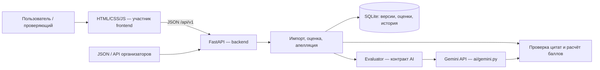
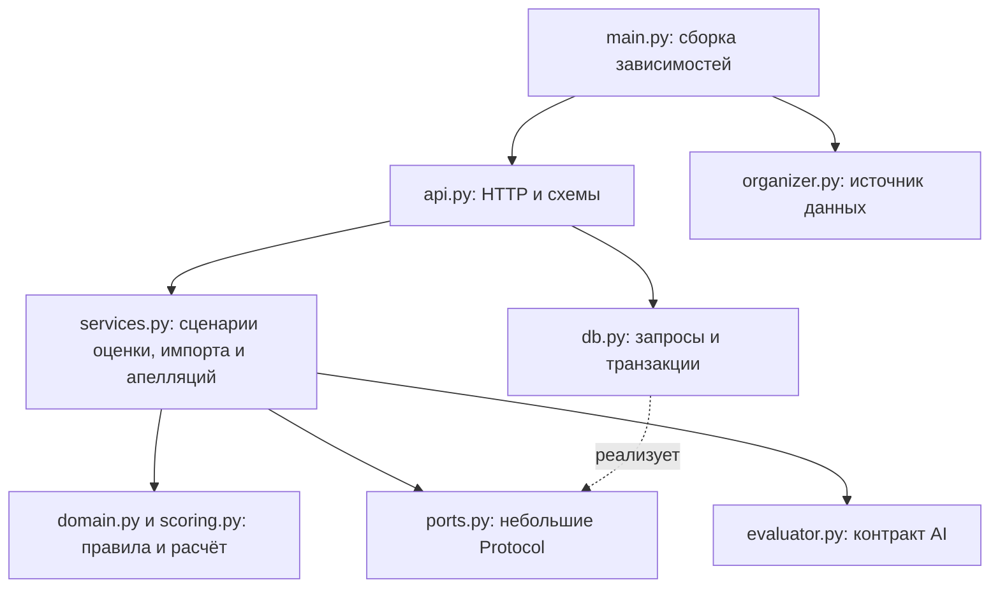
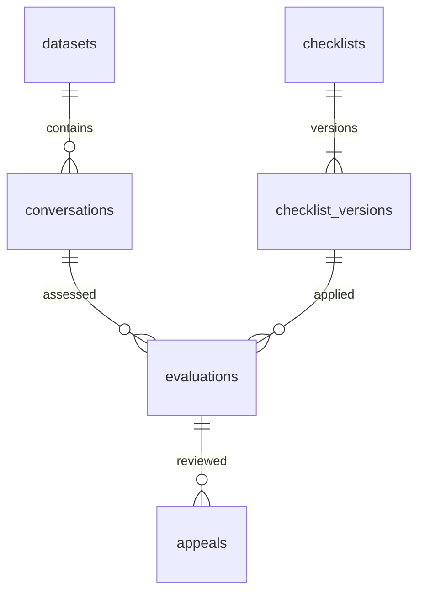

# Архитектура

Один Python-сервис, один SQLite-файл, отдельный браузерный клиент и заменяемый AI-адаптер. Такой объём можно интегрировать за 22 часа. Redis, отдельный сервер БД и микросервисы сейчас не нужны.

Для размещения подготовлены Dockerfile и compose.yaml: один backend-контейнер
и постоянный локальный том для SQLite/WAL. Код API и слои приложения не меняются.
[Инструкция запуска, обновления и восстановления](deployment.md).

## Общая схема и текущее состояние

В `main` объединены backend, существующий frontend и Gemini-адаптер.
`ai.app:app` передаёт адаптер в backend; `ai.app:create_hosted_app` сохраняет
hosted-обёртку со статикой и резервными копиями. Модель возвращает ответы,
пояснения и цитаты; итог считает backend. Без `GEMINI_API_KEY` автоматическая
оценка возвращает `503 AI_NOT_CONFIGURED`, а ручной сценарий продолжает работать.
Прежний `backend.main:app` остаётся точкой входа без AI для совместимости.

Схемы находятся в блоках Mermaid: на GitHub откройте вкладку **Preview**. Обычное копирование текста страницы может не включать рисунок. [Проверка требований и ручная приёмка](acceptance.md), [подключение frontend](frontend-handoff.md), [контракт AI](ai-integration.md).

## Границы модулей

Сервисы получают зависимости через конструктор. Они используют только нужные им методы хранилища: отдельные `EvaluationStore`, `AppealStore`, `DatasetStore`. Для источника наборов есть `DatasetSource`. Реальный SQLite-адаптер один; отдельный класс на каждую таблицу сейчас не нужен. Обычные чтения маршруты делегируют хранилищу напрямую, без промежуточных классов, повторяющих один вызов.

`domain.py` создаёт оценку и применяет решение ревьюера к копии состояния; не выполняет ввод-вывод. `scoring.py` проверяет значения и цитаты и возвращает типизированный `Score`. `models.py` задаёт входные и выходные контракты. `http.py` содержит представление ошибок и ASGI-ограничение тела запроса без обращения к приватным полям Request. `observability.py` удаляет query-параметры из сообщений HTTPX, которые иначе могут содержать подпись ссылки организаторов.

В `errors.py` определены бизнес-коды и специальная ошибка `InvalidEvaluationResult` для нарушений чек-листа/доказательств. HTTP-статусы существуют только в таблице `ERROR_HTTP_STATUS` HTTP-адаптера. При проверке данных AI перехватываются `ValidationError` Pydantic и `InvalidEvaluationResult`; ошибки построения собственной записи, включая `TypeError` и `AttributeError`, доходят до обработчика внутренней ошибки сервера.

`value_types.py` объединяет `Language`, `Channel`, `EvidenceKind` и `NonBlank`. Проверка `NonBlank` отклоняет строку без содержимого, возвращая допустимую строку дословно. Она применяется к входным именам, комментариям и обязательным формулировкам. Для исходных сообщений и чтения прежних подписей/комментариев из БД правила не ужесточены.

## Поток оценки

1. Backend принимает новый набор из JSON или получает его по подписанной ссылке из серверной переменной окружения.
2. Проверяет весь набор до записи; импорт выполняется одной транзакцией.
3. Назначает внутренние UUID диалогам и `m1`, `m2`, … сообщениям. Внешний `conversation_id`, текст, язык, канал и время сохраняет.
4. UI передаёт внутренний UUID диалога и **конкретную** версию чек-листа.
5. Backend передаёт полные тексты и правила в `Evaluator`. В Gemini-точке входа с ключом выполняется реальный запрос; без настройки возвращается 503.
6. Проверяет набор ответов, допустимые значения, условия оформления N/A и соответствие каждой цитаты сообщению. Смысловое обоснование и фактическую корректность консультации оценивает модель / человек; совпадение цитаты само по себе этого не доказывает.
7. Сам рассчитывает баллы через `Decimal`. Сохраняет снимки входа, исходные ответы и результат, метаданные модели и время обработки.
8. Решение по апелляции создаёт запись в журнале и новую итоговую оценку. Исходная оценка остаётся доступна.

## Данные

Структура таблиц находится в `backend/schema.sql`, транзакции — в `backend/db.py`. Тексты, снимки и ответы хранятся в JSON-полях, идентификаторы и связи — в обычных колонках с внешними ключами. Подключения короткие, включены WAL и `foreign_keys`. Схема 0.2 совместима с исходной; существующая база открывается без переноса или удаления данных.

INSERT-запросы явно перечисляют колонки. SELECT-запросы, превращаемые в модели ответа, также выбирают только нужные поля. Интеграционный тест проходит импорт, версии, оценку, апелляцию и экспорт после добавления необязательной колонки во все таблицы. Длинные SQL-запросы оформлены многострочно с отдельными предложениями JOIN/WHERE/ORDER BY.

- Внешний `conversation_id` уникален **внутри набора**. Повторный импорт создаёт новый набор, не перезаписывает старый.
- Версия чек-листа неизменна. Обновление требует `expected_version`; конфликт возвращает 409.
- Оценка хранит `original`, `original_score`, `final`, `score`, `revision`, `reviews`, `metadata`, `input_hash`.
- У одного критерия оценки может быть одна открытая апелляция. Решение требует текущую `expected_revision`, принимается транзакционно и сохраняет новые доказательства. Отклонить жалобу можно решением с прежним значением и объяснением.
- Сервис подготавливает решение вне транзакции. Хранилище в `BEGIN IMMEDIATE` проверяет открытость апелляции и выполняет обновление с условием `WHERE revision = expected_revision`. Изменение оценки и апелляции фиксируется вместе. Ответ читается до commit и соответствует принятому решению.
- Чтения используют явный `BEGIN`, чтобы оценка и её апелляции принадлежали одному снимку. Экспорт читает весь набор в одной транзакции, без отдельного подключения для каждой оценки.
- AI получает глубокие копии входов. Его ответ проверяется относительно исходного диалога и правил; изменение объекта внутри адаптера не меняет аудит. Повторно проверяются и уже созданные Pydantic-объекты.
- `input_hash` позволяет сопоставить входы, но не служит доказательством обращения к модели. Журнал метаданных и реальные повторные запросы показываются отдельно. Готовых ответов по ID диалога нет.

## Арифметика

Для бинарного критерия доля равна 1 при `yes` и 0 при `no`. Для шкалы — выбранное значение / максимум шкалы. N/A исключает вес из знаменателя. Тип `flag` имеет нулевой вес и добавляет ID в `flags` при `yes`.

Итог вычисляется из неокруглённых вкладов и затем округляется до двух знаков. Отображаемые вклады тоже округляются, поэтому сумма отображаемых строк иногда может отличаться на 0,01. `raw_points` — вклад до перераспределения, `points` — после него, `effective_weight` — вес после исключения N/A. Нет применимых весов — итог `null`, не 0 и не 100.

## Интеграционные решения

- API: `/api/v1`, JSON, схема `/openapi.json`, интерактивные запросы `/docs`.
- CORS: по умолчанию локальные адреса frontend на 5173 и localhost:3000; другие задаются в `.env`.
- Одиночная оценка синхронная для клиента, с тайм-аутом модели 180 секунд по умолчанию. Дополнительно есть пакетные задания с состоянием в SQLite и опросом статуса через API. Idempotency-Key позволяет повторить получение успешной оценки. Отмена страницы не гарантирует отмену уже начавшегося запроса провайдера.
- Синхронные HTTP-обработчики FastAPI выполняются в пуле потоков. В асинхронных сценариях обращения к SQLite явно вынесены через `asyncio.to_thread`. Внешние сетевые обращения остаются асинхронными. Тайм-аут модели требует корректной обработки отмены самим адаптером; это не принудительное завершение процесса модели.
- Ошибки возвращают `error.code` и `error.message`. Некорректный результат модели не сохраняется как успешная оценка.
- Подписанный URL организаторов используется только на сервере. Ответы и ошибки не содержат эту ссылку. Аудио backend не скачивает.
- AI-адаптер можно внедрить через `create_app(settings, evaluator)` без изменения арифметики, БД и frontend.

## Выполнение и отчёты

`EvaluationCoordinator` в execution.py окружает существующий EvaluationService:
добавляет ограничение нагрузки, резервирование ключа и журнал запуска.
`ExecutionStore`, `BatchStore`, `OwnerStore` — небольшие Protocol для этих сценариев.
`WorkStore` составляет операции с Repository, не наследует и не дублирует расчёты.
Финализация оценки, журнала и элемента пакета атомарна; существующий insert выделен
в общий write_evaluation. Новые таблицы добавляются через CREATE IF NOT EXISTS,
существующие JSON оценки не переписываются.

`BatchService` вызывает тот же координатор. `ExecutionRuntime` владеет жизненным
циклом потребителя и heartbeat. Аренда владельца отделяет активные задания другого
процесса от прерванных: при старте нельзя просто сбрасывать все running-записи.
Просроченные running-задания не повторяются; ещё не захваченные pending возобновляются.
При отмене уже запущенная запись SQLite завершается до освобождения ресурсов.

`reports.py` содержит чистые функции сравнения и стоимости. QualityReportService
через QualityReportStore читает явно выбранные записи в одном снимке; API и CLI
benchmark используют этот общий сценарий, не зависящий от модели. Статистика расхода
использует необязательные агрегированные ProviderUsage; без подтверждения адаптера
полнота неизвестна. Тарифы находятся в конфигурации, арифметика — Decimal.

Границы и команды описаны в [backend-operations.md](backend-operations.md).

Создание пакета и привязка его Idempotency-Key выполняются одной транзакцией в
WorkStore. Отдельная таблица batch_creation_requests сохраняет хеш ключа, хеш
запроса и исходный ответ. Общая чистая функция request_fingerprint используется
для пакетов и одиночных оценок. Быстрая проверка повтора в сервисе позволяет
получить прежний ответ без доступной модели; проверка под write lock предотвращает
два создания при одновременных запросах. Список пакетов читает total и сводки
в одном снимке SQLite, агрегируя элементы только выбранной страницы.

## Проверки и ограничения

`pytest` проверяет расчёт, API, настоящие конкурентные записи в SQLite, откат при сбое посередине решения, согласованность чтения, тайм-аут, изоляцию входов модели, отсутствие блокировки event loop и ограничение потокового тела запроса. `mypy --strict` проверяет backend, Ruff — backend, CLI и тесты. Эти проверки включены в CI для Python 3.11 и 3.12.

`tests/unit` получает чек-лист и входные модели напрямую, без HTTP-клиента или БД. Здесь проверяются арифметика, неизменность исходной оценки, правила пересмотра и валидация. `tests/integration` имеет отдельные фикстуры FastAPI/SQLite, проверяет сохранность транзакций и публичные статусы всех существующих бизнес-кодов.

Оценки и пакеты поддерживают Idempotency-Key; очередь хранится в SQLite. Известные безопасные отказы 429 откладываются и повторяются в пределах бюджета; сетевые прерывания с неизвестным исходом через resume автоматически не повторяются. Разграничения ролей нет; Gemini подключается фабриками ai.app.

Документация библиотек: [FastAPI — структура приложения](https://fastapi.tiangolo.com/tutorial/bigger-applications/), [FastAPI — тестирование](https://fastapi.tiangolo.com/tutorial/testing/). Gemini-адаптер есть в ai/; качество на независимом экспертном эталоне остаётся отдельной задачей AI-участника и команды.

## Отмена и резервное восстановление

Отмена pending и захват задания используют BEGIN IMMEDIATE в WorkStore.
Побеждает одна транзакция: либо interrupted/BATCH_CANCELLED_BEFORE_START и
захват невозможен, либо running и отмена его не затрагивает. В отчёте расхода
отмена до запуска даёт provider_not_called=true и известный ноль без выдуманного
имени модели. Прерывание уже начатого вызова не означает нулевой расход.

HTTP-обработчики отмены и quality синхронные: FastAPI выполняет их в thread pool,
поэтому SQLite не блокирует event loop. Эти два маршрута не требуют новых таблиц;
миграция для журнала повторных попыток описана ниже.

CLI backup не импортирует main и не запускает ExecutionRuntime. SQLite backup API
создаёт снимок работающей WAL-базы; готовые файлы публикуются без перезаписи после
проверок. Восстановление сначала проверяет приватную копию, затем приостанавливает
все незавершённые задания и публикует новый файл. История оценок, апелляций и
исходные ответы идемпотентности сохраняются. [Порядок восстановления](backup-restore.md).

## Адаптер сдачи результатов

`SubmissionService` в `submission.py` получает `SubmissionStore` и
`SubmissionBatchStore` через Protocol. Сначала читает терминальный пакет, затем
согласованный снимок набора через существующий `Repository.export_dataset`.
Он проверяет исходные AI-оценки, вызывает общую арифметику и переводит внутренние
коды в формат организаторов. API и `submission_cli` используют один сервис.
`submission_remote` обращается к этому API и проверяет структуру и соответствие
запросу без локального доступа к БД. Оба CLI используют `submission_files`
для строгого чтения JSON и атомарной публикации, расчёт баллов не дублируется.
Старые модели, сохранённые чек-листы и архивный экспорт не изменяются; CLI
не запускает runtime. [Формат и сценарий сдачи](submission.md).

`submission_check` использует тот же SubmissionService локально и download из
submission_remote по HTTP. Он суммирует валидный документ и, по запросу, сравнивает
его с файлом общей функцией matches_json; правила оценки не дублируются. Локальный
Repository открывается с read_only=True (SQLite mode=ro/query_only), без initialize
и миграций. CLI возвращает отдельно готовность экспорта, ошибки диалогов и статус
сверки файла. API и схема БД не изменяются; AI, запись результатов и Git не запускаются.

`scripts/rehearse_backend.py` связывает существующий сценарий frontend_kit и три
CLI сдачи в изолированный HTTP-прогон. LocalServer владеет отдельным процессом
Uvicorn, loopback-сокетом и сигналом остановки; после перезапуска сравнивается
сохранённое состояние. В сценарии используется production UnconfiguredEvaluator,
а файлы всех ошибок явно помечены синтетическими. Общие функции frontend_kit
получили аннотации типов без изменения поведения. [Репетиция](backend-rehearsal.md).

## Размещение сайта и API на одном адресе

Опциональная factory `hosting.create_hosted_app` оборачивает lifespan обычного
приложения, монтирует только каталог frontend и выполняет проверенные снимки SQLite
на том же HTTP host. При штатной остановке сначала закрывается runtime, затем
создаётся финальная копия. Обычная `main:app` и её API не изменены.
На alwaysdata HTTP использует локальный XFS, а SSH — NFS, поэтому работа с живой
БД из SSH запрещена. [Фактическая конфигурация](alwaysdata.md).
Hosted-фабрика принимает необязательный keyword-only `evaluator` и передаёт
его в composition root. Без аргументов сохранён прежний запуск через --factory
и ошибка AI_NOT_CONFIGURED. Внедрение не меняет владение ресурсами адаптера:
их lifecycle определяет интеграционная фабрика AI-участника.

## Ограничение запросов и безопасное продолжение

`backend/rate_limits.py` содержит RequestLimiter и небольшой RateStore Protocol.
SQLiteRateStore сериализует разрешение на запрос и хранит cooldown по модели;
MemoryRateStore используется отдельными CLI. Оба внедряются через RequestGate
в адаптер. Gemini-адаптер вызывает gate перед каждым HTTP-обращением, включая
повторы; `ai/rate_errors.py` переводит HTTP 429 в безопасные структурированные
подсказки без сырых сообщений и ключей. Промпт и правила оценки не меняются.

ProviderDeferred сохраняет прежний HTTP-код AI_UNAVAILABLE, но позволяет
координатору отличить известный отказ от неизвестного результата вызова.
WorkStore одной транзакцией завершает запись попытки и откладывает элемент.
BatchService продолжает только допустимые pending после retry_at. Resume
делегирует короткую транзакцию в рабочий поток. Успешные и прерванные элементы
не запускаются повторно, отдельный вызов никогда не отменяется ради лимита.

`migrations.py` транзакционно убирает UNIQUE с execution.item_id: один элемент
получает несколько отдельных попыток с сохранённым расходом. Добавлены таблицы
provider_limits и batch_retry_state; старые JSON оценок не переписываются.
[Контракт и ограничения](backend-operations.md#10-частота-запросов-429-и-продолжение-пакета).
